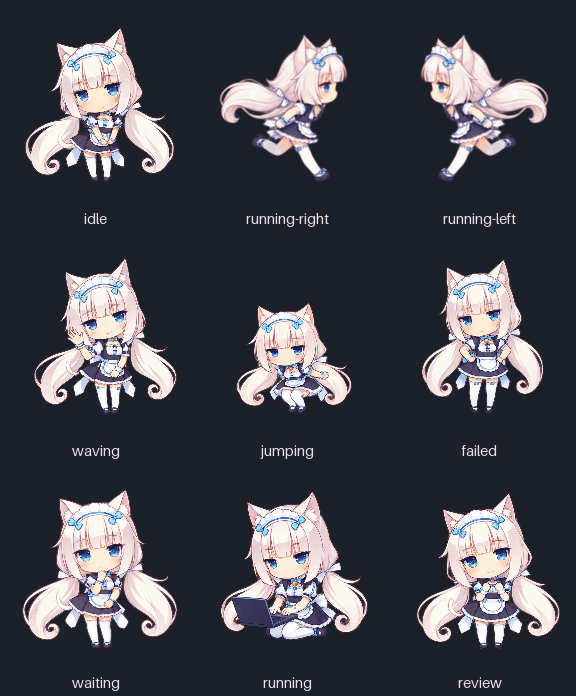

# Vanilla Dot



Девять анимаций Ваниллы (Vanilla) из **NEKOPARA** — неофициальный фанатский аватар. В наборе есть GIF для просмотра, отдельные кадры, полосы кадров и исходные изображения, сгенерированные в ходе работы над этим проектом.

[Открыть галерею](index.html) · [Официальная страница Ваниллы](https://nekopara.com/en/character/vanilla.html)

## Просмотр

Скачайте проект и откройте `index.html` в браузере. Галерея работает локально, без сервера и сетевых ресурсов.

| Анимация | Кадров |
| --- | ---: |
| Покой | 6 |
| Бег вправо | 8 |
| Бег влево | 8 |
| Приветствие | 4 |
| Прыжок | 8 |
| Ошибка | 8 |
| Ожидание ответа | 6 |
| Работа за ноутбуком | 6 |
| Готово! | 6 |

Прыжок использует последнюю версию из восьми кадров. Одобренные GIF бега сохранены без изменения байтов. Старые варианты и отклонённый прыжок из пяти кадров в проект не включены.

## Файлы

- `animations/` — GIF, отдельные PNG-кадры, полосы `strip.png` и доступные листы `keyframes.png`.
- `sources/` — восемь сгенерированных исходных PNG: семь состояний и общий источник для бега в обе стороны.
- `animations.json` — число кадров, длительности в миллисекундах, геометрия и относительные пути. `running` означает работу за ноутбуком; бег обозначен `running-right` и `running-left`.
- `manifest.json` — размеры и SHA-256 всех поставляемых файлов, кроме самого манифеста.
- `rebuild.py` — пересборка производных файлов из готовых кадров.
- `build-dot.py` — сборка установочного PNG-атласа Dot v1.
- `dist/vanilla-dot-v1.png` — прозрачный атлас 1536 × 1872; `dist/manifest.json` описывает строки, выбранные кадры и SHA-256 источников.

## Пересборка

Нужны **Python 3** и отдельно установленный **ImageMagick 7**, доступный как `magick`. Скрипт использует только стандартную библиотеку Python, ничего не скачивает и не устанавливает.

```sh
python3 rebuild.py
```

Если `magick` отсутствует в `PATH`, укажите путь к исполняемому файлу:

```sh
python3 rebuild.py --magick /path/to/magick
```

Результат появится в `build/`: GIF, полосы и листы кадров для всех девяти состояний. Повторный запуск заменяет только производные файлы внутри `build/`; поставляемые GIF остаются нетронутыми.

Мастерами для этой пересборки служат отдельные готовые кадры. Исходные большие PNG сохранены для дальнейшего редактирования. Точный исходный растеризатор на Canvas здесь не поставляется: скрипт не повторяет автоматическую нарезку и масштабирование больших PNG. Поэтому пересобранные GIF могут отличаться по палитре и байтам в зависимости от версии ImageMagick. Для семи состояний используются сохранённые кадры превью на тёмном фоне; для бега — исходные кадры бега. У бега влево кадры зеркально отражены.

## Статус и права

Подготовлен атлас **Dot v1**: восемь столбцов, девять строк, ячейка 192 × 208. Неиспользуемые ячейки прозрачны. Формат v1 не требует 16 направлений взгляда. Аватар **не установлен**; исходные GIF и их длительности сохранены.

### Установка в Codex

После публикации PNG в этом репозитории откройте [ссылку установки Vanilla](codex://pets/install?name=Vanilla&imageUrl=https%3A%2F%2Fraw.githubusercontent.com%2FKarikatun%2Fvanilla-dot%2Fmain%2Fdist%2Fvanilla-dot-v1.png&spriteVersionNumber=1). В окне Codex проверьте превью, нажмите **Install**, затем **Use this pet**. Ссылка передаёт приложению только имя, прямой HTTPS-адрес PNG и версию формата. Команды или отдельный установщик запускать не нужно. Описание формата ссылки — в [официальной документации Codex](https://learn.chatgpt.com/docs/app/commands).

Codex сам задаёт длительность кадров: PNG не передаёт пользовательские тайминги. Поэтому движения после установки отличаются по ритму от GIF в галерее. В текущем приложении прыжок использует пять кадров: приседание, отрыв, верхнюю точку, спуск и приземление. Для атласа взяты исходные кадры 1, 2, 4, 5, 6 (нумерация с нуля); полное одобренное превью из восьми кадров сохранено в `animations/jumping/`.

Бег собран из прозрачного исходника с теми же кадрами и выравниванием, что в одобренном превью, затем уменьшен под ячейку Dot. Бег влево — точное отражение бега вправо. Тёмный фон GIF в атлас не входит.

### Пересборка атласа

```sh
python3 build-dot.py
```

Как и для `rebuild.py`, нужны Python 3 и ImageMagick 7; путь можно передать через `--magick /path/to/magick`. Скрипт работает локально и заменяет только `dist/vanilla-dot-v1.png` и `dist/manifest.json`.

Ванилла и NEKOPARA принадлежат соответствующим правообладателям; официальный источник сведений о персонаже — [NEKOPARA](https://nekopara.com/en/character/vanilla.html). Проект не связан с правообладателями и не является официальным продуктом. Публикация этого набора не предоставляет лицензию на персонажа или сторонние художественные материалы. Отдельная лицензия на графику не заявлена.
